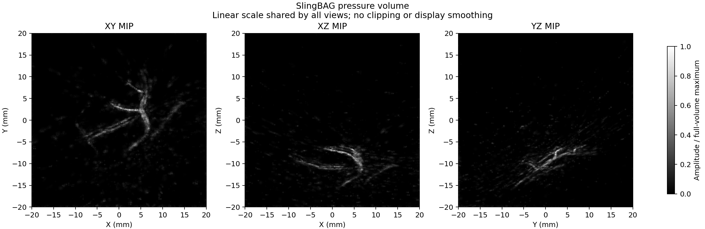

# SlingBAG_3D-PanoPACT

[中文说明](README.md) · [Upstream SlingBAG](https://github.com/JaegerCQ/SlingBAG) · [Method](docs/METHOD.md) · [Data conventions](docs/DATA.md) · [New-data details](docs/NEW_DATA.md)

## Overview

SlingBAG_3D-PanoPACT is a standalone research implementation for reconstructing a
3D photoacoustic pressure field from randomly initialized Gaussian sources. It
includes reconstruction code, one processed experimental frame
(`group03_pose000`), sensor coordinates, configurations, and a completed point
cloud and volume example. Previous experiment directories are not required.

This is a **SlingBAG-inspired algorithm variant**. It combines a continuous
analytic Gaussian acoustic model, TV/curvature regularization of an approximate
pressure field, moment-preserving source splitting, and stagewise Gaussian
widths. Source positions are optimized continuously after each stage's warmup;
widths remain fixed within each stage. Initialization uses random points without
PA, DAS, or hybrid reconstruction images. See the [method description](docs/METHOD.md)
for differences from the upstream algorithm.

## Display of reconstruction results



*Included pose000 result: XY, XZ, and YZ maximum-intensity projections in physical
millimetre coordinates. All three views share the full-volume maximum and use a
linear scale, without percentile clipping or display smoothing.*

The example in `examples/pose000/final/` contains **592,864 nonzero Gaussian
sources**, from one million initial random sources and 1.42 million candidates
after splitting. The volume has `400³` voxels at `0.1 mm` spacing, stored in ZYX
order. The final model used all 1024 sensors for point fitting and subsequent
shared-response calibration; its normalized RF MSE of **199.567426 is an in-sample
fit**, not an independent test result.

The reconstruction shows major vessel branches, while weak-branch continuity and
background separation remain below the earlier PA-initialized hybrid comparison.
See the [comparison figure](docs/assets/final_comparison.png) and
[results and limitations](docs/RESULTS.md). The comparison volumes are not runtime
inputs, and these images do not establish anatomical accuracy without ground truth.

## Guidance

To reconstruct your own frame, provide a signed RF matrix and matching sensor
coordinates. Sensor count and waveform length are inferred from the arrays;
sound speed and sampling frequency are configurable. Preparation converts the
declared layouts and coordinate units, computes this frame's global RMS gain,
and writes a dataset snapshot under your run directory.

- RF defaults to `[sensor,time]`; `[time,sensor]` is also supported.
- Sensor coordinates default to `[sensor,XYZ]`; `[XYZ,sensor]` is also supported.
- Coordinate units can be metres, millimetres, or centimetres. Prepared
  coordinates are in metres, with sensor row order preserved.
- NPY, NPZ, TXT, CSV, and MATLAB v5–v7.2 MAT inputs are supported. Multi-variable
  NPZ/MAT files require an explicit variable key. MAT v7.3/HDF5 must first be
  converted to NPY or an older MAT format.

RF row `i` must correspond to sensor `i`. Layout conversion does not reorder
channels or register coordinates. Supply the preprocessing appropriate to your
acquisition: the importer does not filter, take absolute values, flip polarity,
crop, or resample signals. The included RF is already processed, **not raw ADC**.

This release requires **`t0_seconds = 0`** and retains a fixed XYZ reconstruction
box of **±20 mm**, with **400³ voxels at 0.1 mm**. The first voxel centre is
XYZ = `[-19.95,-19.95,-19.95] mm`. Changing acquisition parameters does not change
that field of view or establish reconstruction quality on a new dataset.

## Installation

Run these commands from this project directory. The tested environment is Linux,
Python 3.10, PyTorch 2.5.1+cu121, Triton 3.1.0, NumPy 1.26.4, SciPy 1.15.3,
Matplotlib 3.10.8, and an NVIDIA A100 40 GB.

```bash
python3.10 -m venv .venv
source .venv/bin/activate
python -m pip install --upgrade pip
python -m pip install torch==2.5.1 --index-url https://download.pytorch.org/whl/cu121
python -m pip install -r requirements.txt
python scripts/verify_package.py
python scripts/check_environment.py --cuda
```

The PyTorch command follows the
[official version instructions](https://pytorch.org/get-started/previous-versions/#v251).
Reconstruction needs an NVIDIA GPU, a compatible local CUDA Toolkit containing
`nvcc`, a C++ compiler, and Ninja. The PyTorch runtime wheel does not replace the
CUDA compiler. Triton accelerates volume export; a slower PyTorch fallback is
available. Other GPUs' memory requirements have not been measured here.

Preparation, checks without `--cuda`, and previews run on CPU. `run.sh` uses the
active `python`; select another interpreter with
`SLINGBAG_PYTHON=/path/to/python ./run.sh ...`. The first GPU reconstruction call
compiles the extension. Build and runtime caches stay inside this project.

## Usage

### View the included result or reconstruct pose000

```bash
# CPU preview of examples/pose000/final/volume_zyx.npy
python scripts/preview.py

# Short execution check: 4096 initial sources, 3 iterations per stage
./run.sh reconstruct.py --config configs/smoke.json

# Full reconstruction from fresh random sources
./run.sh reconstruct.py --config configs/pose000.json
```

The preview is saved as `outputs/preview.png`. The smoke run checks execution;
it is not a quality reconstruction. The full pose000 run prepares data in
`outputs/pose000/data/` and writes results to `outputs/pose000/final/`.
It does not initialize from the included example point cloud.

### Input and acquisition parameters

These are the schema version 2 fields. CLI overrides apply to the selected
configuration; “JSON only” means no CLI override exists. Relative paths are
resolved from the project root, including paths in a configuration stored
elsewhere. Absolute input paths are accepted.

| JSON key | CLI override | Unit, values, and default |
|---|---|---|
| `input.signal` | `--signal` | RF file; default `data/pose000/signal_original.npy` |
| `input.sensors` | `--sensors` | XYZ file; default `data/pose000/sensor_locations.npy` |
| `input.signal_key` / `input.sensors_key` | JSON only | NPZ/MAT variable name; default `null`, automatically selected only for a single variable |
| `input.signal_layout` | `--signal-layout` | `sensor_time` (default) or `time_sensor` |
| `input.sensor_layout` | JSON only | `sensor_xyz` (default) or `xyz_sensor` |
| `input.coordinate_unit` | `--coordinate-unit` | `m` (default), `mm`, or `cm` |
| `input.frame` | JSON only | Label; supplied config uses `group03_pose000`. Change or remove it for new data; `--signal` sets it to the filename stem |
| `input.signal_skiprows` / `input.sensors_skiprows` | JSON only | Nonnegative header-row count for TXT/CSV; default `0` |
| `input.signal_delimiter` / `input.sensors_delimiter` | JSON only | Optional single-character delimiter; default whitespace for TXT, comma for CSV |
| `acquisition.sound_speed_m_s` | `--sound-speed` | Positive m/s; default `1500` |
| `acquisition.sampling_frequency_hz` | `--sampling-frequency` | Positive Hz; default `40000000` (40 MHz) |
| `acquisition.samples` | `--samples` | JSON `null` / CLI `auto` (default) infers length; a positive integer only validates input length |
| `acquisition.t0_seconds` | JSON only | Seconds; only `0` is supported |
| `normalization.target_rms` | `--target-rms` | Positive numerical RF RMS; default `15.941105800921543` |
| `sensor_split.file` | JSON only | NPZ with `train` / `validation`, or `null` (default) to generate a split |
| `sensor_split.validation_fraction` | JSON only | Fraction in `(0,1)`; default `0.125` |
| `sensor_split.seed` | JSON only | Split seed; default `20261008` |
| `seed` | `--seed` | Reconstruction seed; default `1013`, independent of the split seed |
| `default_output` | `--output` | Run subdirectory under `outputs/`; default `outputs/pose000` |

`samples` never crops, pads, or resamples a waveform. Sampling interval is derived
as `dt_seconds = 1 / sampling_frequency_hz` and used by the acoustic model. Sensor
count must agree between RF and coordinates. Automatic splitting uses a seeded
permutation and clamps `round(N × validation_fraction)` to `[1,N−1]`, so both
subsets are nonempty; at least two sensors are required.

### Reconstruct a new frame from start to finish

Copy the complete configuration. Replace the two input paths below with your
files. This example assumes RF `[N,T]`, sensor XYZ `[N,3]` in metres, sound speed
`1480 m/s`, and sampling frequency `20 MHz`.

```bash
cp configs/pose000.json configs/my_frame.json

python - <<'PY'
import json
from pathlib import Path

path = Path("configs/my_frame.json")
config = json.loads(path.read_text())
config["description"] = "My frame: random Gaussian reconstruction"
config["input"].update(
    signal="/path/to/processed_rf.npy",
    sensors="/path/to/sensor_xyz.npy",
    signal_key=None, sensors_key=None,
    signal_layout="sensor_time", sensor_layout="sensor_xyz",
    coordinate_unit="m", frame="my_frame",
)
config["acquisition"].update(
    sound_speed_m_s=1480.0,
    sampling_frequency_hz=20000000.0,
    samples=None, t0_seconds=0.0,
)
config["sensor_split"]["file"] = None
config["default_output"] = "outputs/my_frame"
path.write_text(json.dumps(config, indent=2) + "\n")
PY

# Prepare this frame without GPU training
./run.sh reconstruct.py --config configs/my_frame.json \
  --output outputs/my_frame --prepare-only

# Check its prepared arrays and newly calculated RMS gain
python scripts/check_environment.py --data-dir outputs/my_frame/data

# Continue the same configuration and output directory
./run.sh reconstruct.py --config configs/my_frame.json \
  --output outputs/my_frame --resume

# Preview this run's volume using its metadata
python scripts/preview.py --volume outputs/my_frame/final/volume_zyx.npy \
  --metadata outputs/my_frame/data/metadata.json \
  --output outputs/my_frame/preview.png
```

To run everything in one invocation, omit `--prepare-only` on the **first**
invocation. Once preparation has completed, use `--resume` as shown above. Keep
the same configuration and any CLI overrides when resuming. Prepared datasets
are reused only when their configuration, source hashes, and stored files agree;
a changed dataset is not silently overwritten.

For a separate run, common settings can also be overridden directly:

```bash
./run.sh reconstruct.py --config configs/my_frame.json \
  --signal /path/to/another_rf.npy --sensors /path/to/another_xyz.npy \
  --sound-speed 1500 --sampling-frequency 40000000 --samples auto \
  --coordinate-unit mm --output outputs/another_frame
```

NPZ/MAT keys, sensor layout, and text import options remain in the JSON. More
format examples and the standalone preparation command are in
[NEW_DATA.md](docs/NEW_DATA.md).

### Automatic normalization

Preparation stores original signed RF as float32 and calculates one global gain
for that frame, using all sensors and time samples:

```text
measured_rms = sqrt(mean(signal_original ** 2))
global_gain = normalization.target_rms / measured_rms
signal_normalized = signal_original * global_gain
```

RMS accumulation uses float64. No mean is subtracted, and every sensor receives
the same positive gain. Zero-energy or non-finite inputs are rejected. The gain
and achieved RMS are recorded in `outputs/<run>/data/metadata.json`.

Do not reuse pose000's historical gain `0.2612356995077034` for a new frame.
Do not normalize prepared `signal_normalized.npy` again: training reads it
directly. To recover original input amplitudes, divide the RF prediction by this
run's `global_gain`. The target RMS defines a numerical scale, not an absolute
pressure calibration. Because normalization uses the complete frame, it is not
preprocessing fitted exclusively on the training subset.

### Reconstruction stages and outputs

The full configuration runs coarse fitting, conservative splitting, fine fitting,
width reduction, narrow-source fitting, and a response diagnostic. Its final
branch starts from the width-reduced initial proposal, fits all sensors without
FIR, then calibrates a shared response with fixed ridge `10`. This is sequential
point fitting followed by response calibration.

For the new-frame example above, the final files are in
**`outputs/my_frame/final/`**:

| File | Contents |
|---|---|
| `checkpoint.pt` | Source `xyz`, peak `pressure`, and `radius`; radius means Gaussian standard deviation σ in metres |
| `point_cloud.ply` | Nonzero Gaussian centres, peak coefficients, and σ |
| `volume_zyx.npy` | Float32 pressure volume, shape `[400,400,400]`, ZYX order |
| `acoustic_signal_normalized.npy` | Acoustic prediction before response convolution |
| `predicted_signal_normalized.npy` | Prediction after shared-response calibration |
| `predicted_signal_original_units.npy` | Calibrated prediction divided by this frame's gain |
| `response_kernel.npy` | Shared empirical FIR; 41 taps by default |
| `metrics.json` / `response_calibration.json` | RF errors, evaluation scope, and response details |
| `preview.png` | Automatically generated orthogonal MIPs |

The data snapshot is in `outputs/my_frame/data/`; logs are in
`outputs/my_frame/logs/`, and `config.json` / `run.json` record the effective
configuration and stage completion. To also export a MATLAB volume, set
`export_mat` to `true` in the copied configuration before starting a new run.

## Tips

- `--dry-run` prints stage commands. The smoke configuration checks execution,
  not reconstruction quality.
- `--resume` checks configuration, code, input hashes, and completed artifacts.
  Keep original input files available and unchanged. An interrupted training
  stage restarts from its stage input, not an intermediate Adam state. Use a new
  output directory after changing code, data, or parameters.
- Allow approximately 5 GB for a full new pose000 run. The distributed frame and
  example payload is about 361 MiB. Different data sizes change storage and GPU
  demand. Floating-point atomic accumulation prevents guaranteed bitwise replay.
- Pose000 training settings are starting points for new data. Changing σ, the
  prior grid, batch size, or regularization can change the result. CIC variance
  compensation requires `σ > grid_spacing / sqrt(6)`.
- FIR taps represent sample offsets; changing sampling frequency changes their
  physical time span. The fitted response may absorb model error and is not an
  independently measured instrument response. Final response calibration leaves
  source parameters and the exported pressure volume unchanged.
- Reserved sensors used to select settings are tuning data. After all-sensor
  refitting and calibration, both original subsets are training data. Neither
  low RF error nor a smooth MIP alone proves anatomical accuracy.
- `nvcc` must be available even if `nvidia-smi` works. Set `CUDA_HOME` and `PATH`
  for a compatible Toolkit. Compilation targets the current GPU by default;
  `SLINGBAG_CUDA_ARCH` or `TORCH_CUDA_ARCH_LIST` can select an explicit architecture.

```bash
python scripts/verify_package.py
python scripts/check_environment.py --cuda
./run.sh -m unittest discover -s tests -v
./run.sh scripts/check_cuda.py --run
```

The environment check performs discovery, short CUDA arithmetic when requested,
and data validation. Extension compilation and numerical behavior are covered by
the CUDA check and smoke run. See [validation notes](docs/VALIDATION.md).
If downloaded arrays contain Git LFS pointers, run `git lfs pull` first.

## BibTeX

The upstream SlingBAG repository supplies the following citation for its method.
This package does not claim a separate paper or the upstream paper's performance
results for this variant.

```bibtex
@article{li2025slingbag,
  title={SlingBAG: point cloud-based iterative algorithm for large-scale 3D photoacoustic imaging},
  author={Li, Shuang and Wang, Yibing and Gao, Jian and Kim, Chulhong and Choi, Seongwook and Zhang, Yu and Chen, Qian and Yao, Yao and Li, Changhui},
  journal={Nature Communications},
  year={2025},
  publisher={Nature Publishing Group UK London}
}
```

## License

The upstream MIT license and copyright notice are retained in [LICENSE](LICENSE).
No separate experimental-data license was supplied; the code license does not
establish redistribution rights for the included data. This package is a local
standalone project; no remote repository was created as part of packaging.
