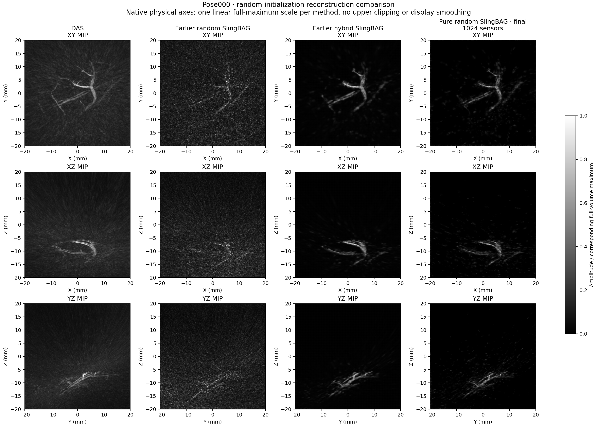

# pose000 示例结果与限制

该示例从全立方体中的 IID 随机点开始，不使用 PA、DAS 或 hybrid 的图像结构初始化。全程保持非负幅度，使用连续解析 Gaussian 声学前向，并对近似的完整物理场施加 TV + 二阶 Hessian 正则。共享 FIR 来自本次随机模型自身的预测和 RF。

## 开发过程的精简对照

下表 MSE 均使用同一归一化 RF 和完整 4096 点时间窗。128 个保留探头用于模型选择，数值是**调参验证结果**，不是独立测试结果。步骤编号在各个阶段内从零开始。

| 变体 | σ / 先验网格 | λ | 选中步骤 | 896 训练 MSE | 128 调参验证 MSE |
|---|---|---:|---:|---:|---:|
| 100 万随机球，弱正则 | 0.25 mm / 160³ | 0.3 | 0 | 254.344 | 255.614 |
| 100 万随机球 | 0.25 mm / 160³ | 1 | 700 | 233.900 | 253.845 |
| 100 万随机球，强正则 | 0.25 mm / 160³ | 3 | 700 | 253.033 | 254.488 |
| 质量、质心和协方差守恒的 8 子球分裂 | 0.15 / 0.25 mm，200³ | 1 | 200 | 206.015 | 253.241 |
| 同一分裂初始化，提高正则 | 0.15 / 0.25 mm，200³ | 1.5 | 700 | 219.373 | 249.179 |
| 细球缩至 0.10 mm，逐球保持 Pσ³ | 0.10 / 0.25 mm，288³ | 1.5 | 500 | 219.479 | 245.125 |
| 上述窄球模型加自身共享 FIR | 同上，ridge=10 | 1.5 | 0 | 191.976 | **237.014** |

弱正则组到第 700 步训练 MSE 降至 182.894，但验证 MSE 升至 273.073，所以选回初始状态。细化 λ=1 组也在第 200 步后出现验证恶化。加入共享 FIR 后再做 200 步点更新，验证 MSE 从 237.014 变为 237.310，因此未采用这些进一步点更新。

缩小 σ 的阶段仅保持每球积分质量与位置，**不保持协方差或完整场/RF**。其 step 0 单独评估。先验中的 CIC 沉积和离散 Gaussian 平滑是近似；声学前向和示例最终体素化使用解析 Gaussian 模型。

完整精简数值表见 [`examples/pose000/experiment_summary.json`](../examples/pose000/experiment_summary.json)。原始中间 checkpoint 与全部训练目录没有打包。

## 打包的最终全探头示例

最终步骤从本次随机流程的窄球初始模型开始，以固定 λ=1.5、288³ 先验网格和 500 步迭代对全部 1024 探头复拟；点训练期间不使用 FIR。随后固定之前选定的 ridge=10，在全部 1024 探头上拟合共享 FIR。**这是先点训练、后响应校准，不是联合优化。**

| 范围 | 声学点模型 MSE | 响应校准后 MSE |
|---|---:|---:|
| 全部 1024 探头 | 224.365045 | **199.567426** |
| 原 896 探头子集 | 223.144015 | 197.570005 |
| 原 128 探头子集 | 232.912261 | 213.549369 |

这一表全部是拟合内指标。不能将最终原 128 子集的 213.549 与前表 237.014 解释为泛化性能提高。最终整体相关系数为 0.522766，相对 L2 误差为 0.886189。响应校准降低整体 MSE 约 11.05%，未改变任何点参数、点云文件或体积数值。

查看 [`examples/pose000/final/metrics.json`](../examples/pose000/final/metrics.json) 和 [`response_calibration.json`](../examples/pose000/final/response_calibration.json) 可追溯声学模型与校准后指标；`metrics_acoustic.json` 保留校准前记录。FIR 是经验校正，可能吸收带宽、时间响应和模型误差，不能认定为实测仪器冲激响应。

## 图像表现

此图来自同一坐标网格，显示各方法的正交最大强度投影；各方法分别按自身完整体积最大值归一显示，没有额外显示平滑或百分位裁剪。图片中的历史方法只作比较，参考体积没有随包分发，也不参与本项目训练。

本次随机方案恢复了部分主要干支结构，但细分支连续性和背景清洁程度仍逊于使用 PA 结构初始化的 hybrid 结果。历史 hybrid 在相同调参划分上的 RF MSE 为 229.521，低于本次随机模型的 237.014；它使用不同结构先验与初始化，因此这不是仅改变一个因素的公平 A/B 实验。

这些比较没有解剖真值支持。低 RF MSE、较平滑的投影或较低背景能量都不能单独证明重建正确；单帧结果也不能代表其他样本或采集条件。当前项目提供独立、可复现的随机点云实现与示例，没有达到“与 hybrid 同等结构质量”的证据。
